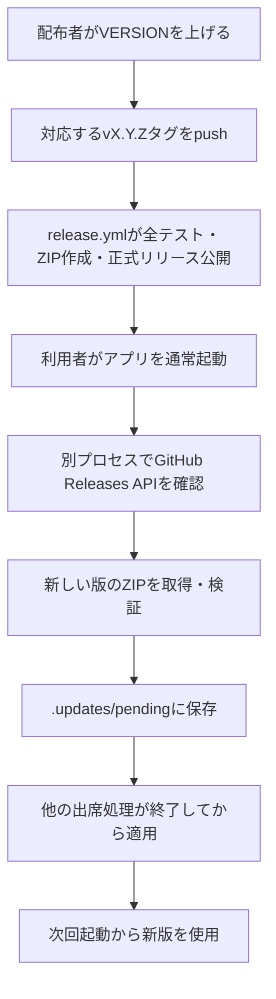

# 自動アップデートの仕組みと検証結果

検証日: 2026-11-14。相手の環境で発生したエラーの文面・ログは取得できていないため、HTTP 403を原因として確定していない。

## v0.2.1時点の仕組み

以下は2026-11-14に検証したAPI方式の記録。v0.2.2以降は[公開JSON方式](update-manifest.md)へ移行した。



- `tests.yml` はpush・PR時にテストする。更新を公開する `release.yml` は `v*` タグのpushで起動する。mainへのpushだけでは配信されない。
- 通常起動時に更新用プロセスを起動する。通信は正常な確認から24時間、通信失敗から1時間の間隔を空ける。常駐タイマーによる定時確認ではない。
- `att update` は間隔を待たずに手動確認する。通常起動後に短時間で終了しても、更新プロセスはダウンロードを続ける。
- 出席の自動実行、デモ、ヘルプ、バージョン表示、ユーザー管理、予定管理では自動更新を開始・適用しない。`ATTENDANCE_NO_UPDATE=1` も自動更新を無効にする。
- APIの `tag_name` と現在の `src/version.py` を数値で比較する。古い版、同じ版、ドラフト、プレリリースを適用しない。
- 配布元URL、SHA-256、ZIPの構成・展開量、必須モジュール、Python構文、タグと内部バージョンの一致、依存ライブラリ、`--help` による起動を確認する。
- 準備中はアプリ本体を変更しない。適用時にバックアップと復元記録を作り、ファイルを置き換える。読み込まれた実行中の版はそのまま終了し、新版は次回起動から使う。
- 他の出席処理が動いていれば適用を延期する。適用中の失敗では復元し、中断が残っていれば次回のアプリ読込前に復元する。
- `att update --rollback` で直前の更新前の版に戻せる。同じリリースを自動で再適用しない。
- `config.json`、`schedule.json`、Keychain、ログ、ブラウザデータ、`.venv`、`.git` は更新対象外。Git・ZIP導入とも同じ更新経路を使い、git pullは実行しない。

## 検証した範囲

更新関連: **71テストメソッド・216ケース、失敗0件**。サブテストを個別のケースとして数え、サブテストの親メソッドを重複して数えていない。

最終確認では、ブラウザの模擬画面を含むアプリ全体の**150テストが成功**した。配布用ZIPの作成と受信側検証、配布対象17ファイルのPython 3.10構文検証も成功した。

| 分類 | 主なケース | 結果 |
| --- | --- | --- |
| 通信 | API・ZIPそれぞれでHTTP 400/401/403/404/407/408/410/422/429/500/502/503/504、DNS、証明書、TLS、タイムアウト、拒否、切断、受信不足 | 成功 |
| 通信の境界 | サイズ上限ちょうど・超過、通信期限超過、読み込み途中の障害、レスポンスの終了処理 | 成功 |
| リリース情報 | 正式版なし、旧版・同版・新版、ドラフト、プレリリース、不正なJSON・タグ・アセット・チェックサム | 成功 |
| 配布ZIP | 壊れたZIP、ファイル欠落、重複、ディレクトリ、パス逸脱、シンボリックリンク、展開量・件数超過、Python構文エラー | 成功 |
| 実行環境 | 依存ライブラリ変更、起動確認失敗・タイムアウト・Python実行失敗、実行権限とキャッシュ削除 | 成功 |
| 保存 | 容量不足・権限不足を確認記録／展開／メタデータ／適用時に注入、原子的書き込み失敗 | 成功 |
| 状態データ | 壊れた確認記録、未来時刻・非数値・極端な数値、通知破損、準備データ破損・欠落・中断、再取得 | 成功 |
| 同時実行 | ダウンロード・実行ロック、手動更新の延期と終了コード、実際の別プロセスによるロック保持と解除 | 成功 |
| 適用・復元 | 個人設定保持、ファイル追加・削除、先頭・途中・末尾の置換失敗、適用後の確定処理失敗、復元データ不足、継続する容量不足、次回起動での復旧 | 成功 |
| 起動条件 | 通常CLI・GUI、手動更新、自動更新無効、scheduled/demo/help/version/user/schedule、更新プロセスを起動できない場合 | 成功 |
| 実プロセスの通し検証 | Gitあり・Gitなしの隔離コピーで、本体終了後の別プロセスによる取得・検証・適用、新版起動、ロールバック | 成功 |
| 配布作成 | タグ不一致、必須モジュール不足、個人設定の除外、生成ZIPの受信側検証 | 成功 |

通信障害・ディスク障害は隔離コピーに対して注入し、実際の個人設定・出席データは変更していない。通し検証ではネットワーク応答だけを模擬し、プロセス起動・取得処理・検証・ファイルロック・適用・復元は実装を動かしている。

## 今回再現して修正した問題

| 修正前の挙動 | 修正後の挙動 |
| --- | --- |
| 壊れた確認記録や不正な時刻で更新が停止する | 不正な記録を無効として再確認する |
| 壊れた・途中までの準備データを再利用し続ける、または上書きに失敗する | 不正な準備データを破棄して再取得する。破損後の自動再取得で24時間待たない |
| 通知JSONの配列・null等で通常起動が止まる | 不正な通知を無視して通常起動を続ける |
| 通知を保存できないと、エラー処理中に別の例外が出る | ログ出力を残し、通知保存の失敗では二重に例外を出さない |
| GUI・出席処理等のモジュールが欠けたZIPでも検証を通過する | すべての必須モジュールを配布側・受信側で確認する |
| 不正な復元記録を無視して起動する、または復元途中でバックアップ不足に気づく | 変更前に全復元データを検証する。破損・不足時は記録を保持し、アプリ読込前に停止する |
| 別プロセスが動いていると手動更新を保留しても終了コード0になる | `更新待機:` と終了コード1を返す |
| 適用失敗の具体的な理由が汎用メッセージに置き換わる | 元の原因を表示する |

通信診断も改善し、DNS・HTTPS証明書・TLS・タイムアウト・HTTPステータス・受信中の切断を区別する。例外に含まれる任意の本文やパスはそのまま表示しない。

## 公開前に配布側で確認できた事実

- [GitHub Releases](https://github.com/HR0101/AttendanceSystem/releases) は0件。最新版APIは正式リリースなしの404を返す。
- [最新の公開CI実行](https://github.com/HR0101/AttendanceSystem/actions/runs/39372053718) は成功。取得できた全28件の履歴はTestsで、配布ジョブの実行はない。
- 正式リリースを公開するには、修正版のバージョンを上げ、対応するタグをpushする必要がある。この異常系検証の時点では公開・タグ作成・pushを実施していない。

正式リリース未公開という事実と、相手の環境で見た接続エラーの原因は別に扱う。相手のエラー原因の確定には、その環境の実際の表示か `.updates/updater.log` が必要になる。

## 再実行

```sh
.venv/bin/python -m unittest discover -s tests -p 'test_updater*.py'
.venv/bin/python -m unittest discover -s tests
```

- 更新テスト: [test_updater.py](../tests/test_updater.py)、[test_updater_matrix.py](../tests/test_updater_matrix.py)
- 今回のケース別結果: `dist/updater-audit/results.json`
- 今回の実行ログ: `dist/updater-audit/tests.log`

実行環境はmacOS・Python 3.12.6。配布対象のPythonコードは3.10の構文でも検証した。Python 3.10/3.11実機や相手のネットワークでの実行結果を意味するものではなく、OS・ネットワークの全組み合わせを網羅したとはしていない。行の実行率も分岐網羅率とは区別する。
